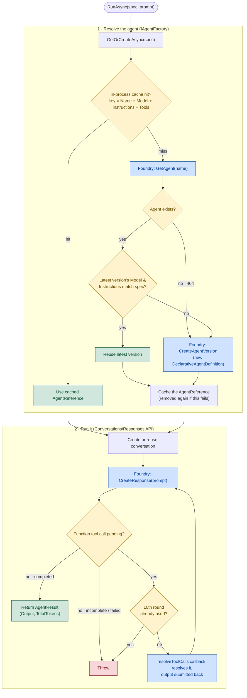

# Dfe.Ai.Agents

Reusable .NET building blocks for Azure AI Foundry agents: creation/versioning, run execution,
multi-agent orchestration, MCP tool discovery, and Azure AI Search (RAG) context. No dependency on
the Briefing Tool's own types — safe to reference from any project.

Built on Foundry's **Prompt Agent / Conversations+Responses** model (`Azure.AI.Projects`,
`Azure.AI.Projects.Agents`, `Azure.AI.Extensions.OpenAI`), not the older Threads/Runs API. This is
required for Admin-connected model gateway connections (`<connection-name>/<model-name>` as the
model string).

## Install

```xml
<ProjectReference Include="..\Dfe.Ai.Agents\Dfe.Ai.Agents.csproj" />
<!-- or, once packed: <PackageReference Include="Dfe.Ai.Agents" Version="0.2.0" /> -->
```

## Quick start

```csharp
services.AddFoundryAgents(
    endpoint: sp => new Uri(foundryEndpoint),
    credential: sp => new ClientSecretCredential(tenantId, clientId, clientSecret),
    optionsFactory: sp => new FoundryAgentFactoryOptions(DefaultModel: "my-connection/gpt-4o"));
```

```csharp
var spec = new AgentSpec { Name = "ofsted-agent", Instructions = "You summarise Ofsted inspection findings for a school." };
var result = await agentRunner.RunAsync(spec, "Summarise the latest inspection outcome for this school.", cancellationToken: ct);
Console.WriteLine(result.Output);
```

`Model` (`AgentSpec.Model` / `FoundryAgentFactoryOptions.DefaultModel`) is a deployment name — for a
gateway connection that's `<connection-name>/<model-name>`, not just the connection name.

## How agents are created, cached, and run

`IAgentRunner.RunAsync` always goes through `IAgentFactory.GetOrCreateAsync` first. The factory
keys an **in-process** cache on `Name + Model + Instructions + Tools` — call it again with an
identical spec and you get the cached reference with zero Foundry calls. On a cache miss it checks
Foundry itself before creating anything, so redeploys don't leak duplicate agent versions: an
existing agent whose latest version already matches wins; anything else gets you a new version.
Once an agent is resolved, the runner sends the prompt through the Conversations/Responses API —
no polling, a response comes back synchronously — looping only while the model is waiting on a
function tool call (capped at 10 rounds).



*Blue = calls out to Foundry · yellow = a branch point · green = success · red = throws.*

A failed creation isn't cached — the next call for that spec gets a fresh attempt, not the same
cached exception.

## Orchestration

```csharp
var orchestrator = new AgentOrchestrator(agentRunner);
var context = new AgentContext();

// Sequential: each agent's output feeds the next.
await orchestrator.RunSequentialAsync([ofstedSpec, synthesisSpec], "Draft a briefing for this school.", context, cancellationToken: ct);

// Parallel, shared input: every specialist looks at the same school.
await orchestrator.RunParallelAsync([ofstedSpec, trustSpec], "URN 123456, Test Academy", context, maxConcurrency: 5, cancellationToken: ct);

// Parallel, independent input per agent — each specialist pulls its own evidence category.
var steps = new List<AgentOrchestrationStep>
{
    new(ofstedSpec, async ct => (await contextRetriever.GetContextAsync("ofsted_index", "Test Academy inspection", 10, ct)).Text),
    new(trustSpec, async ct => (await contextRetriever.GetContextAsync("trust_index", "Test Academy trust", 10, ct)).Text),
};
await orchestrator.RunParallelAsync(steps, context, cancellationToken: ct);
```

A failed step is recorded in `OrchestrationResult.Results`, not thrown — pass `shouldSuppress` to
make specific failures propagate (e.g. a mandatory step). `RunSequentialAsync` prepends prior
history to each prompt; `RunParallelAsync` deliberately doesn't (concurrent steps are independent).

## MCP tools

`appsettings.json` (no built-in config-binding helper for this one — bind the section yourself):

```json
{
  "Mcp": {
    "ServerLabel": "school-performance-mcp",
    "ServerUri": "https://school-performance-mcp.example.com",
    "Authentication": {
      "TenantId": "...",
      "ClientId": "...",
      "ClientSecret": "...",
      "Scope": "api://school-performance-mcp/.default"
    }
  }
}
```

```csharp
services.AddMcpClientServices(sp =>
    sp.GetRequiredService<IConfiguration>().GetSection("Mcp").Get<McpServerConnectionOptions>()
    ?? throw new InvalidOperationException("Missing 'Mcp' configuration section."));
    // AllowedToolNames omitted = every tool the server reports; GetToolsAsync throws if a name you list isn't there.
```

`IMcpToolClient` (real MCP protocol client, `ModelContextProtocol.Core`) is for **discovery** only
(`tools/list`, `prompts/list`/`prompts/get`) — actual tool *invocation* is still Foundry's own job at
run time via the tool definition `GetToolsAsync()` builds. `GetPromptAsync(name, args)` returns a
server-hosted prompt as plain text. `RequireApproval: true` isn't resolved automatically yet
(`RunAsync` throws instead of silently succeeding empty) — leave it `false` (default) until it is.

## Azure AI Search context (RAG)

`appsettings.json` (real shape from this repo's own `Dfe.Briefing.Tool.Web`):

```json
{
  "AzureSearch": {
    "Endpoint": "https://my-search.search.windows.net",
    "TenantId": "...",
    "ClientId": "...",
    "ClientSecret": "...",
    "Indexes": ["establishment_index", "ofsted_index"],
    "MinimumRelevanceFilter": 0.5,
    "MaxRetryAttemps": 3
  }
}
```

```csharp
services.AddAzureSearchContextRetriever(configuration); // binds "AzureSearch" section, validates on start
```

```csharp
var context = await contextRetriever.GetContextAsync("establishment_index", query, size: 10, ct);
// context.Text: formatted, relevance-filtered evidence (or a "no results" placeholder)
// context.HasEvidence: false when nothing matched
```

The scope you pass to `GetContextAsync` must be one of the configured `Indexes` names — that's how
this registration maps scope → `SearchClient`. Register your own `SearchClient`s directly against
`IContextRetriever`/`AzureSearchContextRetriever` instead if you want arbitrary scope names or don't
want config-driven wiring.

## Assigning context and tools to an agent

RAG evidence and MCP tools plug into an `AgentSpec` two different ways — evidence becomes part of
the *prompt* (it changes per call), tools become part of the *agent definition* (Foundry caches/
versions them along with everything else in the spec):

```csharp
var evidence = await contextRetriever.GetContextAsync("establishment_index", searchQuery, size: 10, ct);
var tools = await mcpToolClient.GetToolsAsync(ct);

var spec = new AgentSpec
{
    Name = "establishment-agent",
    Instructions = systemPrompt,   // static — cached/versioned on the Foundry agent itself
    Tools = tools,                 // MCP tools this agent may call
};

var prompt = $"Evidence:{Environment.NewLine}{evidence.Text}"; // per-call, not cached
var result = await agentRunner.RunAsync(spec, prompt, cancellationToken: ct);
```

Changing `Tools` (or `Instructions`/`Model`) changes the factory's cache key (see "How agents are
created, cached, and run" above), so a different tool set gets its own agent version rather than
silently reusing one created for a different tool set.

## Prompt templating

```csharp
services.AddSingleton<IPromptTemplateStore>(sp =>
    new FilePromptTemplateStore(pathsByKey, path => File.ReadAllText(path), fallback: key => "You are a general-purpose assistant."));
services.AddSingleton<IPromptTemplateBuilder, PromptTemplateBuilder>();
```

`Build(key, values)` does `{{Token}}` substitution. Already have your own lookup? Use
`new DelegatingPromptTemplateStore(myLookupMethod)` instead.

## Notes for consumers

- **Keys are `string`, not generics** — `SystemPromptType`/`EvidenceCategory`/scope/template keys are
  plain strings, not a closed enum, since this package has unknown consumers. Convert at your own
  boundary if you want a compile-time-checked set (`nameof(MyEnum.Value)` in, `Enum.Parse` out).
- **`ResilientAgentStep.ExecuteAsync`** is the fallback-on-failure helper `AgentOrchestrator` already
  uses internally; reach for it directly only when composing an agent call outside the orchestrator.
- **Testing**: `FoundryAgentFactory`/`FoundryAgentRunner` depend on `AgentAdministrationClient` and
  `IFoundryConversationClient` respectively — both directly substitutable with NSubstitute. `McpClient`
  (the underlying MCP SDK type) has no public constructor or interface, so substitute `IMcpToolClient`
  instead of trying to fake the protocol.
- **Not yet supported**: MCP tool-call *approval* submission (function tool-call outputs only);
  MCP tool-call *execution* proxying (Foundry brokers `tools/call` itself); a router/hand-off
  orchestration pattern.
